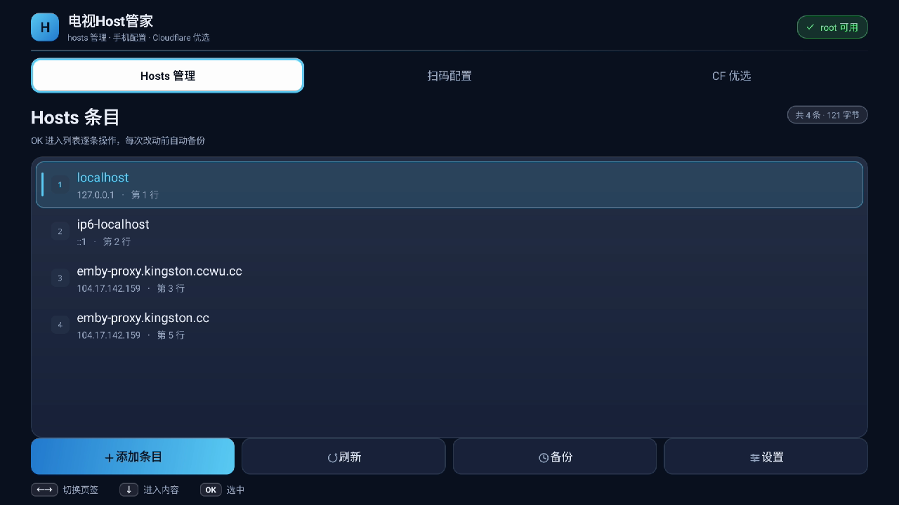
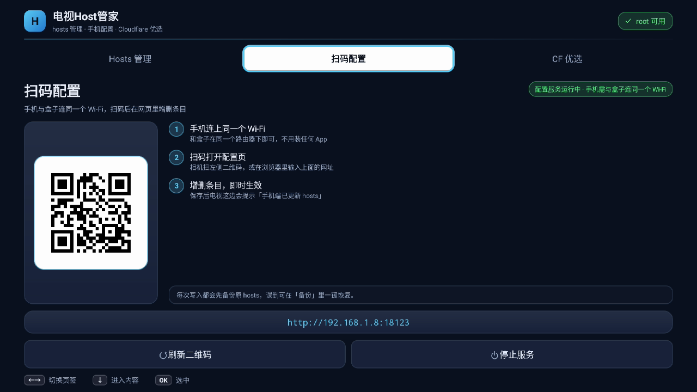
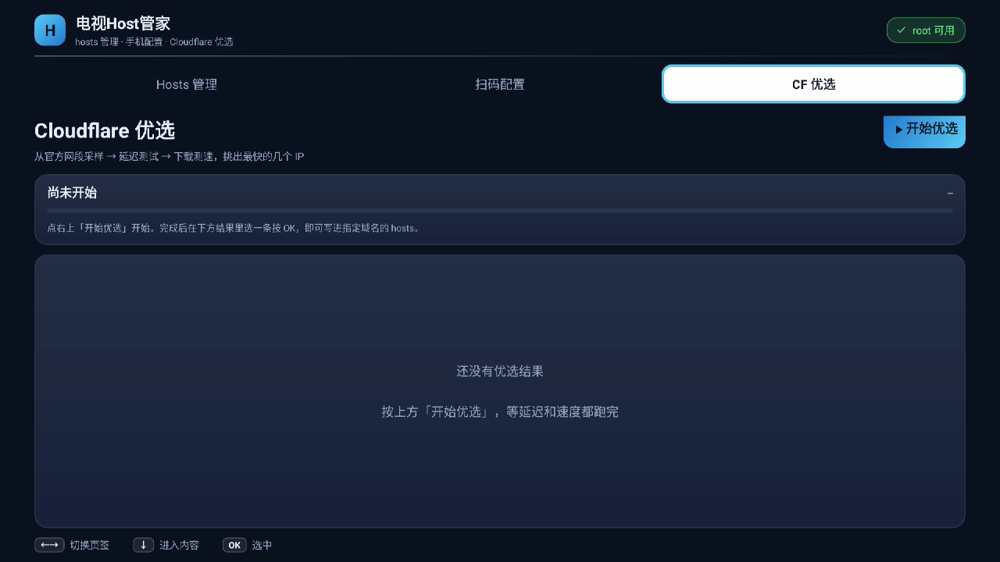

# TVHostBox · 电视Host管家

**给 Android 设备用的 hosts 管理工具**：遥控器就能增删 hosts 条目，手机扫码即可在网页里批量编辑，
还能跑 Cloudflare 优选 IP 并一键写成某个域名的解析。

> 通用工具，不绑定具体机型。已在 **移动魔百盒 CM311-1sa（Android 9，已 root）** 上实机长期验证。


---

## 为什么做这个

电视盒子改 hosts 一直很别扭：要么开 adb 敲命令，要么装个手机端编辑器再想办法把文件推过去，
改完还得自己处理备份、权限、remount。

这个 App 把这几件事合到一起：

- 坐在沙发上用遥控器删掉一条解析，不用碰电脑
- 手机上扫码打开一个网页，卡片式增删、全文编辑，比遥控器打字快得多
- 内置 Cloudflare 优选（延迟 + 真实下载测速），测完直接把 IP 写成你的域名解析
- 每次写入自动备份，改坏了能一键回滚

## 实测设备

| 项目 | 情况 |
|---|---|
| 机型 | 移动魔百盒 **CM311-1sa**（CM311-1sa-ZG2） |
| 系统 | Android 9 |
| 状态 | 已 root，`/system` 可 remount 读写 |
| 结果 | hosts 读写、备份恢复、扫码配置、CF 测速与写入，全部实机跑通 |

机型只是我的验证环境，程序里没有一行机型相关逻辑：

- **纯 Java，零 native 库**（二维码也是纯 Java 实现），因此 `armeabi-v7a` / `arm64-v8a` / `x86` / `x86_64` 全架构通用
- 不依赖任何厂商 SDK，也没有机型白名单
- `minSdk 21`（Android 5.0），只要设备**已 root 且 `/system` 能 remount 成可写**，理论上都能用：
  电视盒子、Android TV、手机、平板、开发板都行

## 功能

| 功能 | 说明 |
|---|---|
| **Hosts 管理** | 列出 `/system/etc/hosts` 全部条目，选中按 OK 删除；支持手动添加、查看备份列表、一键恢复 |
| **扫码配置** | 设备端显示二维码，手机扫码进入卡片式网页：增删单条、点条目带入修改、全文编辑（内置 HTTP 服务，端口 `18123`） |
| **CF 优选** | 从 Cloudflare 官方 IPv4 网段采样 → TCP 443 并发延迟测试 → HTTPS 真实下载测速 → 按速度排序取前 N 名；过程本身是一张实时刷新的表（序号 / IP / 质量条 / 延迟或速度），跑完可以在「结果列表 ⇄ 测试过程」之间来回切 |
| **优选应用** | 把选中的优选 IP 写成指定域名的解析（写进 hosts，Emby / Jellyfin 直连之类场景立刻见效） |
| **应用内升级** | 顶栏提示 + 设置里手动检查；root 设备一键静默安装。GitHub 连不上时自动降级到国内镜像（gh-proxy / ghfast / ghproxy），再不行用 jsDelivr 兜底只判版本 |

## 界面

> 下图为 1920×1080 真机截图（移动魔百盒 CM311-1sa，Android 9）。

| Hosts 管理 | 扫码配置 | CF 优选 |
|---|---|---|
|  |  |  |

三个页签，遥控器左右切换、上下移动、OK 确认，全程不需要鼠标：

- **Hosts 管理**：条目列表（序号 + `域名 → IP` + 行号 / 注释），一行里只有一个强调色主按钮「添加条目」，
  其余「刷新 / 备份 / 设置」走同一套次级样式，主次一眼可分
- **扫码配置**：左侧二维码卡 + 右侧三步说明左右分栏，16:9 屏幕不再是一根竖条吊在半空
- **CF 优选**：从上到下是「进度卡 → 实时测试表 → 底部按钮行」。跑的时候中间那张表逐条滚出
  `序号 / IP / 质量条 / 延迟(或 Mbps)`，按时延/速度实时重排；跑完表收起来换成结果列表，
  底部多出一枚「查看测试过程」，两套视图随时对调。
  主按钮固定在最下面一整行，不再挤在标题右侧被父容器裁掉上沿
- 整页 44dp 安全边距（1080p 约 5%），不会被电视 overscan 裁掉边

内置 6 套主题（深海蓝 / 石墨橙 / 午夜紫 / 松林绿 / 纯黑 OLED / 日间浅色），设置里一键切换。
所有颜色、控件背景、图标都按主题运行时生成，不写死在资源里。

**状态与焦点用三套视觉语言，绝不混淆**：

- **光标**（在哪）＝ 全屏唯一的近白实心块 + 3dp 强调色环，3 米外一眼定位
- **选中**（记住哪行）＝ 强调色淡底 + 左侧竖条，永远比光标暗一档
- **当前页签**＝ 淡强调底 + 底部短横线 + 强调色字，和"光标块"完全两个样子

**为遥控器设计的两态列表**（长列表不困人）：

- 列表有「框态 / 条目态」两种状态：光标先停在**整个列表框**上（描边高亮），
  此时 ↑ 直接到页签、↓ 直达底部按钮行，**不用一格一格穿过整个列表**；
- 按 OK 才进入条目态逐行浏览，BACK 或 ← 退回框态；光标所在行尾会出现「›」提示按 OK 有下一步；
- 长按 ↑↓ 自动加速（1 → 2 → 4 → 8 行），几十条 hosts 也能快速翻到底；
- 底部是**键帽式按键提示条**（像遥控器上的实体键），跟着焦点位置实时变化，不用背按键。

## 工作原理

**改的是什么**：系统级 `/system/etc/hosts`。它在 `getaddrinfo` 阶段生效，优先于一切 DNS，
不经过任何代理 / 分流库。所以在 CMFA（Clash Meta）、Surfboard 这类工具里配合
`IP-CIDR,<优选IP>/32,DIRECT,no-resolve` 规则，就能让特定域名走优选 IP 直连，其余照常走代理。

**写入流程**（每步都校验，失败不破坏原文件）：

```
备份 /system/etc/hosts → /sdcard/hostbox/hosts.bak.<时间戳>
  → mount -o rw,remount /system
  → 写入新内容
  → chmod 644
  → 回读比对校验
```

root 命令通过一个常驻 `su` 会话执行（自带 20 秒看门狗，会话挂了自动重建重试），
不用每次 fork 一个新的 su 进程。

**扫码配置**：App 在设备 `0.0.0.0:18123` 起一个极简 HTTP 服务，二维码内容就是
`http://<设备IP>:18123`。手机浏览器打开后可列表查看、逐条删除、填「IP + 域名」写入，
或展开全文编辑批量改。手机端只发指令，**写入仍然由设备端完成**，所以每次改动照样自动备份。

## 安装

1. 到 [Releases](../../releases) 下载 `TVHostBox-v<版本号>.apk`
2. 装到设备上，任选一种：
   ```bash
   adb connect <设备IP>:5555
   adb install -r TVHostBox-v<版本号>.apk
   ```
   或者拷到 U 盘插到盒子上用文件管理器装，也可以用电视助手类工具推送。

首次写入 hosts 时 `su` 会弹授权，允许即可（部分系统的授权弹窗在电视上需要遥控器确认）。

**关于更新**：应用内的「检查更新 / 一键升级」需要 root（走 `pm install` 静默安装）。
查版本和下载 APK 都是「直连 → 国内镜像」自动降级，不需要手动配代理；
没有 root 时会直接提示，并给一个「打开发布页」的按钮，改用 U 盘安装。

> 从 v1.0.0（临时签名版）升级需先 `adb uninstall tv.hostbox.app`；
> v1.0.1 起签名固定，之后都能正常覆盖升级。

## 使用

- **删除一条解析**：Hosts 管理 → ↓ 进列表 → OK 进入条目态 → 选中按 OK →
  操作菜单选「删除这一条」→ 确认（默认焦点在「取消」，误按不会删）
- **把已有 IP 用到别的域名**：列表里选中条目 → OK → 「把这个 IP 用到其他域名」→ 填域名写入
- **手机批量配置**：扫码配置 → 手机扫码 → 网页里点条目 ✕ 删除、或点条目带入后改 IP 再保存、
  或展开「高级 · 全文编辑」直接改全文 → 保存即生效
- **优选 IP 并应用**：CF 优选 → 「开始优选」→ 等两轮测速 → 选中一个结果 →
  输入要应用的域名（如 `emby.example.com`）→ 写入
- **改坏了想回滚**：Hosts 管理 → 备份列表 → 选一个时间点恢复（恢复前会先把当前文件再存一份）
- **换主题**：设置 → 主题，6 套即时生效（界面重建后停留原页签）

## 设置项

| 设置 | 可选值 | 默认 |
|---|---|---|
| 主题 | 深海蓝 / 石墨橙 / 午夜紫 / 松林绿 / 纯黑 OLED / 日间浅色 | 深海蓝 |
| 备份保留数量 | 10 / 20 / 50 / 不限 | 20 |
| CF 优选结果保留前几名 | 5 / 8 / 10 / 15 | 8 |
| CF 网段采样数量 | 160（快）/ 320（标准）/ 640（充分） | 320 |
| 每个候选 IP 的测速下载量 | 2 MB（快）/ 6 MB（标准）/ 12 MB（精确） | 6 MB |

采样越多、下载量越大越准，也越慢；一般家用网络用默认值就够。

## 常见问题

**改了 hosts 要重启吗？**
不用，新的 DNS 查询立刻生效。但已经在跑的 App 可能缓存了旧解析，重启那个 App 即可。

**提示没有 root / 写入失败？**
先确认 `su` 可用（`adb shell su -c id` 应返回 `uid=0`），并且 `/system` 分区能 remount 成可写。
少数机型有 dm-verity / AVB 只读保护，这类设备需要先关闭校验才能改系统分区。

**手机打不开那个网页？**
手机和设备要连同一个 Wi-Fi（同一网段），并关掉路由器的 AP 隔离 / 客户端隔离——它会把设备互相屏蔽。
也可以照页面上显示的地址手动输入，或改用有线 IP。

**为什么 targetSdk 停在 28？**
刻意保留低位，规避 Android 10+ 的 scoped storage 和 cleartext 限制——这个 App 要写 `/system`、
要起明文 HTTP 服务，抬上去只是给自己加限制。目标设备是 Android 9 的盒子，够用。

**备份存在哪？**
`/sdcard/hostbox/hosts.bak.<时间戳>`，超出保留数量时自动清理最旧的。

## 自己编译

推任意 commit 到 `main` 就触发 GitHub Actions 自动编译，APK 在构建产物的 Artifacts 里；
打 `v*` 标签会额外创建 Release 并附上 APK。版本号由 tag 驱动
（`v1.0.8` → `versionName 1.0.8`、`versionCode 10008`）。

本地编译（可选，需要 JDK 17 + Android SDK）：

```bash
gradle assembleRelease
```

## 目录结构

```
app/src/main/java/tv/hostbox/app/
├── MainActivity.java    # TV 三页签 UI（遥控器导航、焦点管理）
├── HostsManager.java    # hosts 解析 / 校验 / root 写入 / 备份恢复
├── RootShell.java       # 常驻 su 会话（零依赖版 libsu）
├── ConfigServer.java    # 手机扫码配置的 HTTP 服务（/api/state /api/set /api/delete）
└── CfOptimizer.java     # Cloudflare 优选（延迟 + 下载测速，裸 SSLSocket 手写请求）
app/src/main/assets/mobile.html          # 手机端配置页（自成一体，不依赖任何 CDN）
app/src/main/java/io/nayuki/qrcodegen/   # QR 码生成（Nayuki, MIT）
```

## 兼容性

- **已验证**：移动魔百盒 CM311-1sa / Android 9 / 已 root
- **理论支持**：Android 5.0+ 且已 root、`/system` 可 remount 为可写的任何设备
- **架构**：全架构（纯 Java，无 native 库）
- **界面**：按横屏电视设计（大字号、强焦点态）；竖屏手机也能装能跑，只是布局未专门优化

## 免责声明

本项目仅用于管理自有设备的本地域名解析。请遵守当地法律法规与网络服务条款使用。

## License

[MIT](./LICENSE)（含内嵌的 [Nayuki QR-Code-generator](https://github.com/nayuki/QR-code-generator)，MIT）
